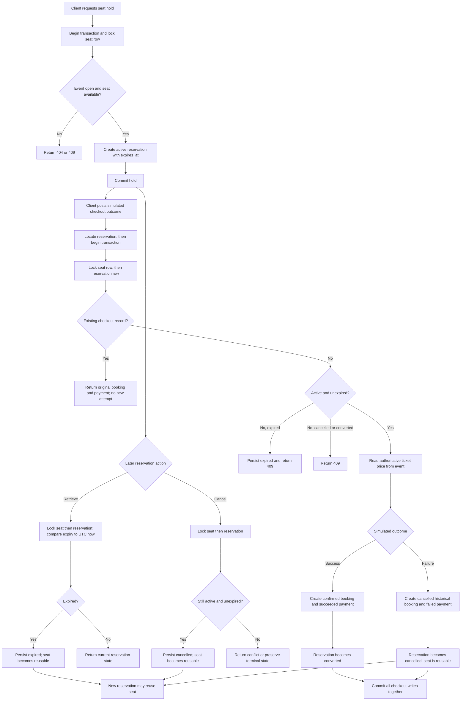

# Reservation and booking workflow

Every mutating reservation/checkout path locks the concrete seat before the
reservation row and uses a database transaction. A database error rolls back
the booking, payment, and reservation transition together. Expiry is lazy: no
background job currently expires untouched holds.
